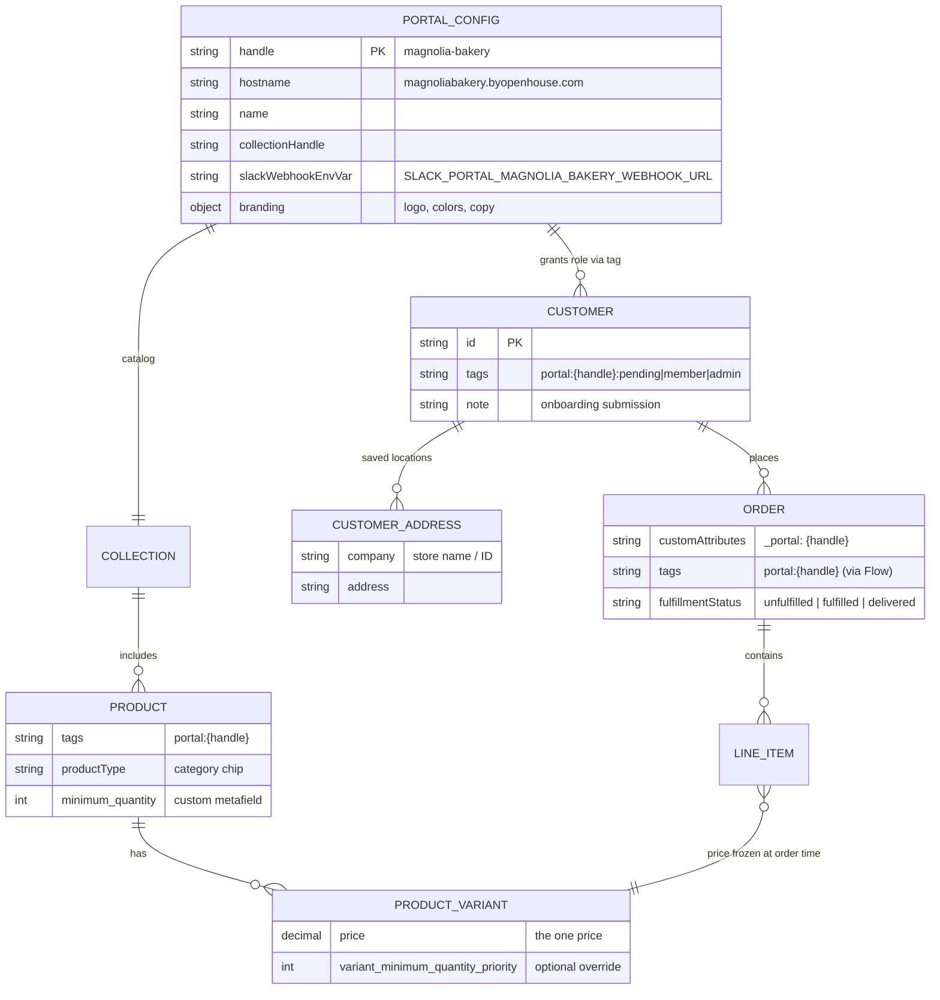
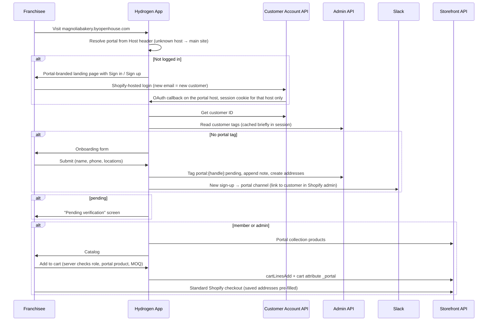

# Franchise Portals — Implementation Plan

**Client:** Openhouse (Chris Breen)
**First tenant:** Magnolia Bakery, at `magnoliabakery.byopenhouse.com`
**Built on:** The existing Hydrogen storefront, standard Shopify customer accounts (Customer Account API), the Admin API helper ([`app/lib/shopifyAdmin.js`](../../app/lib/shopifyAdmin.js)), and standard Shopify checkout. **No Shopify Plus or native B2B.**

This is the single source of truth for the project. Update it in place as decisions change.

---

## 1. Project Summary

Openhouse is the sole merchandise supplier to a corporate client's franchise network. Magnolia Bakery is the first, growing from about 10 to about 150 locations. Each corporate client gets a **portal**: a gated store on its own `byopenhouse.com` subdomain. In the portal, verified franchisees order from a fixed, client-specific catalog at one price per product, with minimum order quantities enforced. Openhouse fulfills orders within four weeks through its normal fulfillment flow.

The system is **tenant-generic**. Nothing in the code is Magnolia-specific. Magnolia is one entry in the portal config plus the Shopify data tagged for it. Adding the next corporate client is a setup task, not a build (see §7).

What a portal does:
1. **Sign up and log in.** A franchisee creates an account on the portal subdomain. They have no access until Openhouse or the client's corporate admin verifies them.
2. **Show the fixed catalog.** For Magnolia, nine products at launch. Each shows photos, description, one price and the MOQ. Franchisees can fine-tune their variant mix (colors, sizes) toward the MOQ.
3. **One price per product.** No tiers, no quantity breaks, no pricing logic. The price is the variant price in Shopify.
4. **Check out through standard Shopify checkout.** Shipping is editable at checkout, and a franchisee's saved locations (customer addresses) pre-fill it.
5. **Show order history.** Portal orders only, with status, tracking and a re-order button that rebuilds the cart.
6. **Corporate admin.** The client's corporate account sees all portal orders across franchisees and can approve or revoke franchisee access.

**Changes from the original brief and the first planning pass:**
- ~~Shopify B2B (Company / Location / Catalog)~~: the store is not on Plus. Access, catalog scoping and MOQ use customer tags, product tags and metafields instead (§2).
- ~~Invoice download / payment terms~~: franchisees pay at standard checkout like any other customer.
- ~~Corporate read-only role~~: the corporate admin can also approve and revoke franchisees.
- New: a **sign-up and manual verification** flow with Slack notification. Automated verification can be added later (§4.3).
- ~~Spend record / budget bar / dashboard stats~~: not in core scope. Possible add-on (§8).
- ~~`OH-YYYY-NNNN` order numbers~~: Shopify order name formatting applies to the whole store, so portal orders use the store's normal numbering.

---

## 2. Data Model

Without B2B, the portal uses plain Shopify primitives and a naming convention. `{handle}` is the portal handle, e.g. `magnolia-bakery`.

| Concept | Shopify primitive | Convention |
|---|---|---|
| Portal (tenant) | Code config, [`app/lib/portals.js`](../../app/lib/portals.js) | One entry per portal, keyed by hostname (§4.1) |
| Pending franchisee | Customer + tag | `portal:{handle}:pending` |
| Verified franchisee | Customer + tag | `portal:{handle}:member` |
| Corporate admin | Customer + tag | `portal:{handle}:admin` |
| Franchise location | Customer address | Store name / ID goes in the address `company` field (e.g. `Magnolia Bakery — MB-014 Austin`) |
| Portal product | Product + tag + collection | Tag `portal:{handle}`, member of the portal's collection |
| MOQ | Existing metafields | Product `custom.minimum_quantity`; variant override `custom.variant_minimum_quantity_priority` (already queried in [`products.$handle.jsx`](../../app/routes/products.$handle.jsx)) |
| Category chips | Product type | Shopify product type (drinkware / bags / counter / home). Confirm it isn't already used differently on the main site. |
| Portal order | Order + cart attribute + tag | Cart attribute `_portal: {handle}` flows to the order's custom attributes. A Shopify Flow rule tags the order `portal:{handle}`. |
| Onboarding details | Customer note | Same append-to-note pattern as [`api.wholesale.jsx`](../../app/routes/api.wholesale.jsx) |

---

## 3. Request Flow

Verification: Openhouse (in Shopify admin) or the portal admin (in the portal) swaps `:pending` → `:member`.

---

## 4. Engineering Workstreams

### 4.1 Portal resolution and routing
- `app/lib/portals.js` maps hostname to portal config. In `createHydrogenRouterContext` ([`app/lib/context.js`](../../app/lib/context.js)), resolve `context.portal` from the request host. An unknown host gives `null`, which means the normal Openhouse site.
- **Why code config, not a metaobject:** portal setup is manual per client anyway, the Slack webhook is a secret (metaobjects can be readable over the public Storefront API), and code config adds no request overhead and is versioned. Branding could move to a metaobject later if Openhouse wants to edit it without a deploy.
- Portal pages live at the **same paths** as the main site (`/`, `/products/$handle`, `/cart`, `/account/*`), plus portal-only routes (`/onboarding`, `/admin/*`). Overlapping routes branch on `context.portal` and delegate to modules in `app/portal/`, so portal code stays separate. Portal-only routes return 404 on the main host.
  - *Why not a `/portal/*` route segment with a server rewrite:* SSR would render the rewritten path, and client hydration would see a different `window.location`. A visible `/portal/...` URL would undercut the subdomain. Validate this approach in the spike (Phase 0).
- On a portal host, any route outside the allowlist redirects to `/`. The root layout ([`app/root.jsx`](../../app/root.jsx) → `PageLayout`) renders a portal header and footer themed from `portal.branding`.

### 4.2 Auth
- Uses the existing Customer Account API integration ([`account_.login.jsx`](../../app/routes/account_.login.jsx)). Each portal host's callback, JavaScript-origin and logout URLs must be registered in the Hydrogen channel's Customer Account API settings.
- The session cookie ([`app/lib/session.js`](../../app/lib/session.js)) sets no `domain`, so it's already host-only. Portal and main-site sessions are isolated with no changes. A franchisee logged into the portal is not logged into byopenhouse.com, which is intended.
- The cart ID lives in that same session, so portal and main-site carts are separate too.
- Shopify's hosted login page and checkout use store-wide (Openhouse) branding. They can't be branded per portal.

### 4.3 Roles, onboarding and verification
- `requirePortalRole(context, roles)` helper: gets the customer ID from the CAA session, reads tags via the Admin API, caches the role in the session with a short TTL (about 5 minutes) so revocation takes effect quickly, and redirects to `/onboarding` or the pending screen as needed.
- **The role is always derived server-side from the session.** Never trust a role, customer ID or portal handle sent from the client.
- Onboarding form fields: name, phone, one or more franchise locations (address autocomplete via Geoapify, same as `/wholesale`). Fields can be extended per portal in config.
- On submit: Admin API `tagsAdd portal:{handle}:pending`, append a summary to the customer note, create the addresses, then post a Slack message to the portal's webhook via `context.waitUntil`. This generalizes `notifySlack` in [`api.wholesale.jsx`](../../app/routes/api.wholesale.jsx) into a shared helper. **Slack is only for new sign-ups.** Orders go through Openhouse's normal fulfillment flow.
- Future automated verification (e.g. checking against a franchise list the client provides) plugs in at this submit step by tagging `:member` directly. No other changes needed.

### 4.4 Catalog visibility
- The portal catalog is the portal's collection, queried with the Storefront API, with category chips from product type.
- **Main site must hide every `portal:*` product.** Each listing needs its own handling:
  - Search ([`search.jsx`](../../app/routes/search.jsx), predictive search): add `-tag:portal*`-style exclusion to the query, or filter results.
  - [`collections.all.jsx`](../../app/routes/collections.all.jsx): exclude by tag.
  - Sitemap: exclude portal products.
  - [`products.$handle.jsx`](../../app/routes/products.$handle.jsx): 404 for a portal-tagged product on the main host or another portal's host.
  - Collections: operational rule that portal products are never added to main-site collections. Optionally also filter in [`collections.$handle.jsx`](../../app/routes/collections.$handle.jsx).
- **Limitation (accepted):** the Storefront API is public, so portal product data can't be made fully secret without B2B. We hide it everywhere in the UI and block it at the cart (§4.6). The risk is low given what's being sold.

### 4.5 Portal product form (wholesale-style variant mix)
- New `PortalProductForm` component, **separate** from the main site's `ProductForm`. Its starting point is the **wholesale mode** of the pre-simplification form. That code was removed in `7b1371d` ("pdp: single unit, retail price") and is documented in [`guides/productForm/productForm.md`](../productForm/productForm.md). Recover it from `git show 7b1371d^:app/components/ProductForm.jsx`.
- Keep: multi-select colors, a per-color size × quantity grid, running totals, an MOQ readout, and add-to-cart of the whole mix as multiple lines.
- Drop: the sample mode, the Order Type selector, and every `orderType` branch. Most of the old code's complexity came from those (see "Summary of complexity sources" in the productForm guide).
- Fix while porting:
  - Selection state stays inside the form, except what the image gallery needs. The old gallery read parent-owned `selectedColors`.
  - Selection becomes `{[variantId]: qty}`, replacing the old `{name, sizes}` shape.
  - Products with no options, color only or size only use the same component. Most of Magnolia's nine have no options and render as a single quantity stepper with the MOQ minimum.
- **MOQ semantics (default; confirm with Openhouse):** the product-level MOQ applies to the **product total across all variants**, so a franchisee can split it across colors and sizes. The variant metafield `variant_minimum_quantity_priority`, if set, enforces a per-variant minimum. (The old form enforced MOQ per color.)
- Lead time is static copy from portal config ("Ships in under 4 weeks"), not the per-variant lead-time or made-to-order logic.
- Inventory: the main site caps at stock. The portal default is to allow any quantity, since Openhouse fulfills within 4 weeks. Confirm.
- Cart line attributes: no `Order Type` / `_order_type` line attributes. Portal identity lives in a single cart-level attribute `_portal` (§4.6).

### 4.6 Cart and checkout
- [`cart.jsx`](../../app/routes/cart.jsx) action, on a portal host: require a `member` or `admin` role, reject merchandise not tagged for this portal, and set the cart attribute `_portal: {handle}`. On the main host: reject `portal:*` merchandise. Also guard [`cart.$lines.jsx`](../../app/routes/cart.$lines.jsx) permalinks.
- MOQ is validated again on the server for lines-add and lines-update, and the cart UI blocks checkout with an inline message when a product's total drops below its MOQ after cart edits.
- **Limitation (accepted):** without Plus, Shopify checkout can't enforce MOQ or portal membership on its own (Cart Validation Functions from custom apps need Plus). A determined user bypassing our app could create an off-policy order. Openhouse's fulfillment review is the backstop.
- Checkout is standard Shopify checkout on the store's checkout domain, shared by all portals. Logged-in customers get their saved addresses (franchise locations) pre-filled, and shipping stays editable.

### 4.7 Order history and re-order
- A Shopify Flow rule ("Order created" + custom attribute `_portal` → add tag `portal:{handle}`) tags portal orders.
- History is loaded server-side via the Admin API with `customer_id:{sessionCustomerId} AND tag:'portal:{handle}'`. The customer ID always comes from the session. The Customer Account API can't filter orders by attribute or tag, and a franchisee's regular Openhouse orders must stay out of the portal.
- Status maps from Shopify fulfillment status (Submitted / Shipped / Delivered), with a tracking link from the fulfillment.
- Re-order rebuilds the cart from the order's variant IDs and quantities, at **current** prices. It skips and reports variants that are no longer available or no longer in the portal, then re-validates MOQ.
- Order emails use Shopify's standard notifications. Optionally, branch the Liquid templates on the `_portal` attribute for light per-portal copy.

### 4.8 Portal admin (corporate)
- `/admin` on the portal host, which requires `portal:{handle}:admin`.
- **Orders:** all orders tagged `portal:{handle}` across franchisees (Admin API), filterable by franchisee, location and date.
- **Members:** customers tagged `portal:{handle}:*` with their status and locations. Actions: approve (`:pending` → `:member`) and revoke (remove `:member`). Server-side, each action re-checks that the target customer is tagged for **this** portal before changing anything.
- Openhouse sets up admins manually in Shopify admin. The portal can't create admins.

---

## 5. Shopify Admin Setup Checklist (per portal)

- [ ] Add the portal entry to `app/lib/portals.js` (hostname, handle, name, collection handle, branding) and deploy
- [ ] Create the Slack channel and incoming webhook; add `SLACK_PORTAL_{HANDLE}_WEBHOOK_URL` to Oxygen environment variables
- [ ] Connect the subdomain in the Hydrogen channel (Oxygen custom domain) and add the DNS CNAME
- [ ] Register the subdomain's callback, JavaScript-origin and logout URLs in the Customer Account API settings
- [ ] Create products: photos, copy, one price, product type (category); tag `portal:{handle}`; set `custom.minimum_quantity`
- [ ] Create the portal collection (portal products only)
- [ ] Keep quoted-but-not-launched products in draft, or untagged, until they launch
- [ ] Create or tag the corporate admin customer `portal:{handle}:admin`
- [ ] (One-time, all portals) Shopify Flow rule: `_portal` order attribute → order tag
- [ ] (Optional) Per-portal branches in order notification templates
- [ ] UAT on the live subdomain

---

## 6. Phases

Hours and billing are tracked in the development hours sheet. This section is scope only.

| Phase | Scope |
|---|---|
| 0. Discovery and architecture | This plan; spike: multi-domain Oxygen + CAA login across hosts + same-path routing approach |
| 1. Multi-tenant infrastructure | Portal config + resolution, route allowlist/guards, main-site product hiding, themed portal layout, public landing page |
| 2. Accounts and verification | Role helper + gating, onboarding form, tagging, shared Slack helper, pending screen |
| 3. Catalog and cart | Catalog + chips, `PortalProductForm` (wholesale port), cart guards, MOQ (UI + server), `_portal` attribute |
| 4. Member account | Portal order history (Admin API), status/tracking, re-order, "My Locations" address UX |
| 5. Portal admin | All-orders view, member approve/revoke |
| 6. QA, launch and handoff | Role / portal / main-site isolation testing, mobile and browser QA, UAT, launch, runbooks (§7) |
| Per portal | §5 checklist (Magnolia first) |

---

## 7. Adding the Next Portal

No code changes beyond a config entry. Follow the §5 checklist. Deliverables for Openhouse:
- **New portal playbook:** the §5 checklist with screenshots
- **Verification runbook:** how Openhouse approves or revokes a franchisee and assigns a corporate admin in Shopify admin

---

## 8. Open Questions

- **MOQ semantics:** product total across variants (current default) or per color, as in the old wholesale form?
- **Inventory:** allow ordering beyond on-hand stock (4-week fulfillment), or cap at stock?
- **Suggested retail price:** defined in the original plan but not in the approved renderings. Show it or drop it?
- **Spend budget / budget bar / dashboard stats** (lifetime spend, units delivered): out of core scope. Quote as an add-on if wanted.
- **Onboarding fields:** anything Magnolia needs beyond name, phone and locations (e.g. franchise agreement number)?
- **Post-checkout return:** Shopify's order status page "continue shopping" link points to the store's primary domain, not the portal. Acceptable, or should we customize the checkout/thank-you page?

---

## 9. Codebase Findings

What the existing repository already provides, and what this plan builds on:

- **Tenant patterns:** none exist. The context ([`app/lib/context.js`](../../app/lib/context.js)) has an empty `additionalContext` hook, which is where `portal` goes.
- **Auth/session:** standard Hydrogen CAA plus a cookie session with no `domain` attribute, so it's host-scoped already. No rework needed, only callback URL registration per host.
- **Admin API:** [`app/lib/shopifyAdmin.js`](../../app/lib/shopifyAdmin.js) (client-credentials token, API `2026-07`) is already used to find, create and tag customers in [`api.wholesale.jsx`](../../app/routes/api.wholesale.jsx). Reuse it for roles, onboarding, order history and the admin views.
- **Slack:** `notifySlack` in [`api.wholesale.jsx`](../../app/routes/api.wholesale.jsx) (webhook via env var, sent with `waitUntil`). Extract it into a shared helper that takes a webhook URL.
- **Metafields:** the `custom` namespace, snake_case keys. MOQ metafields already exist (`minimum_quantity`, `variant_minimum_quantity_priority`), as do `lead_time` and `made_to_order_lead_time`.
- **Wholesale variant UI:** removed from the main PDP in `7b1371d`, documented in [`guides/productForm/productForm.md`](../productForm/productForm.md). It's the starting point for `PortalProductForm`.
- **Cart attributes:** the main site's `ProductForm` tags lines `Order Type: Sample`. Portal lines don't use line-level order-type attributes (§4.5).
- **Routing:** flat file routes ([`app/routes.js`](../../app/routes.js)). No collision for `/onboarding` or `/admin`.
- **Still to confirm:** Oxygen multi-domain behavior on preview deployments, and how to test a second host locally (the `--customer-account-push` tunnel only covers one host). Both are part of the Phase 0 spike.
