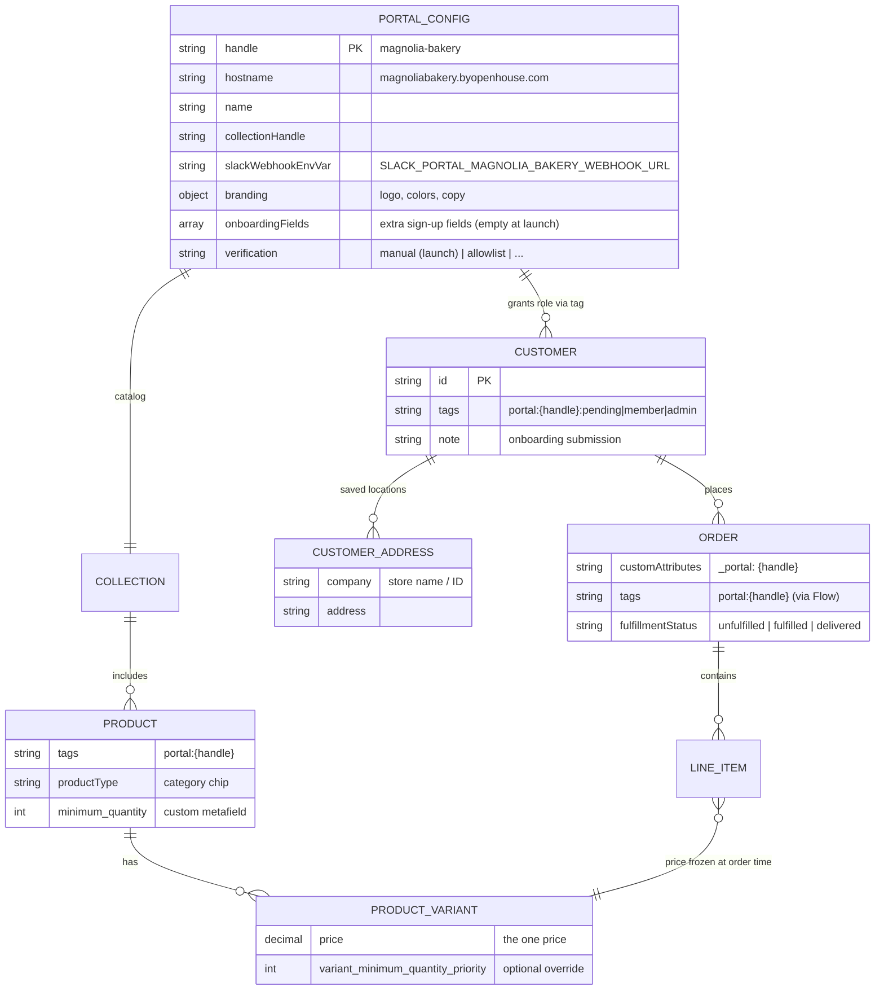
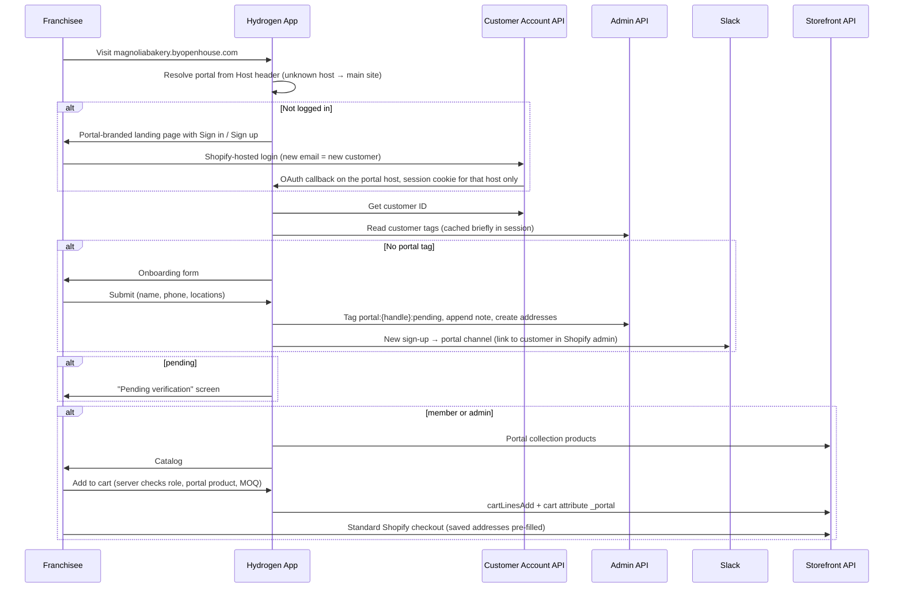

# Franchise Portals — Implementation Plan

**Client:** Openhouse (Chris Breen)
**First tenant:** Magnolia Bakery, at `magnoliabakery.byopenhouse.com`
**Built on:** The existing Hydrogen storefront, standard Shopify customer accounts (Customer Account API), the Admin API helper ([`app/lib/shopifyAdmin.js`](../../app/lib/shopifyAdmin.js)), and standard Shopify checkout. **No Shopify Plus or native B2B.**

This is the single source of truth for the project. Update it in place as decisions change.

---

## Status & Next Steps

_Last updated 2026-10-28. Row numbers refer to request #12 in the development roadmap sheet. Everything below is merged to `main` and live._

| Row | Item | Status |
|---|---|---|
| 12a | Discovery, architecture & plan | Done (this document) |
| 12b | Subdomain spike | Done. "Continue shopping" returns to `www` (confirmed); handled by the return-to-portal redirect (12m). |
| 12c | Portal foundation | Done. Hostname → config, allowlist enforced in `server.js` for every request, noindex, no tracking. |
| 12d | Hide portal products from main site | Done and live. Products **and** the portal catalog collection are hidden; search/collection filter counts are corrected (§4.4). |
| 12e | Branded layout + landing | Structure done; Magnolia branding waiting on assets |
| 12f | Sign-up, verification & gating | Done and live |
| 12g | Slack sign-up notifications | Done and live |
| 12h | Verification extension point | Done (manual at launch) |
| 12i | Portal catalog | Done. Reuses the collection page and filters at `/collections/magnolia-bakery`. |
| 12j | Portal product page | Done and browser-tested: `PortalProductForm` (multi-color, per-size qty, per-color MOQ). Gallery-by-color reorder is optional polish. |
| 12k | Cart & checkout protection | Built: server cart guard (both hosts), `_portal` cart attribute, `_color` grouping, MOQ status + disabled checkout, `/cart/checkout` server re-check. Shopify Flow order tag **verified** on order #1406 (2026-10-28). |
| 12l | Order history & re-order | Done and browser-tested 2026-10-28 (Admin API by customer + Flow tag; re-order works). |
| 12m | My Locations + return to portal | Return-to-portal redirect built 2026-10-28 (**not yet re-tested**: needs one more portal checkout). My Locations not started. |
| 12n / 12o | Corporate admin | Not started (optional) |
| 12p | Magnolia setup | Domain, DNS, login URLs, Slack, API scopes, `magnolia-bakery` collection done. Admin account, branding, playbook to do. |

**Production incident 2026-10-28:** `/account/orders` returned 500 on `www` and the portal for about 30 minutes after the 12l deploy (Customer Account API field the live API rejects). Hotfixed in `b84be6c`; see §4.7.

**Also fixed along the way (main site, not portal scope):** `server.js` dropped Hydrogen's `cart` cookie whenever the session also changed (`set` → `append`); the search page ignored filter/sort params; the search results count and the **filtered collection count** only showed the current page (max 12); the collection count request re-fired on every render.

### Next session
1. **Clean up the test order:** cancel #1406 (restock, refund the $10 shipping) and deactivate `PORTALTEST100` (and the shipping code, if created).
2. **Re-test return-to-portal** with one more portal checkout: "continue shopping" should land on the portal's orders.
3. **12m My Locations:** present the address book as "My Locations" on the portal (store name in the address `company` field, matching sign-up), and check that checkout pre-fills them.
4. **Optional refactor (pending your call):** make Re-order a plain `CartForm` LinesAdd to `/cart`, like the product page, instead of its own action. Less code, one add-to-cart path. Land on `/cart` (recommended) or `/cart/checkout`.
5. Then **12e** branding (needs assets), **12p** wrap-up (corporate admin account, new-portal playbook, verification runbook), and **12n/12o** if approved.

### Open decisions
- Product page "Lead time / Material / Our commitment / Returns" tabs on the portal: keep, hide, or trim to Material + Size chart?
- Optional: reorder the product gallery by selected colors (the old wholesale form did).

### Shopify Flow order tag (12k, verified 2026-10-28)
Trigger *Order created* → condition *custom attributes key = `_portal`* → action *Add order tags*:
`portal:{{ attr.value }}`

### Needed from the client
- Real Magnolia products (tag `portal:magnolia-bakery`; they appear in the `magnolia-bakery` collection automatically if it's an automated collection on that tag; publish only to the Openhouse Hydrogen storefront)
- Magnolia brand assets
- Corporate admin's email (`portal:magnolia-bakery:admin`)
- Decision on 12n/12o

---

## 1. Project Summary

Openhouse is the sole merchandise supplier to a corporate client's franchise network. Magnolia Bakery is the first, growing from about 10 to about 150 locations. Each corporate client gets a **portal**: a gated store on its own `byopenhouse.com` subdomain. In the portal, verified franchisees order from a fixed, client-specific catalog at one price per product, with minimum order quantities enforced. Openhouse fulfills orders within four weeks through its normal fulfillment flow.

The system is **tenant-generic**. Nothing in the code is Magnolia-specific. Magnolia is one entry in the portal config plus the Shopify data tagged for it. Adding the next corporate client is a setup task, not a build (see §7).

What a portal does:
1. **Sign up and log in.** A franchisee creates an account on the portal subdomain. They have no access until Openhouse or the client's corporate admin verifies them.
2. **Show the fixed catalog.** For Magnolia, nine products at launch. Each shows photos, description, one price and the MOQ. Franchisees can fine-tune their variant mix (colors, sizes) toward the MOQ.
3. **One price per product.** No tiers, no quantity breaks, no pricing logic. The price is the variant price in Shopify.
4. **Check out through standard Shopify checkout.** Shipping is editable at checkout, and a franchisee's saved locations (customer addresses) pre-fill it.
5. **Show order history.** Portal orders only, with status, tracking and a re-order button that rebuilds the cart.
6. **Corporate admin.** The client's corporate account sees all portal orders across franchisees and can approve or revoke franchisee access.

**Changes from the original brief and the first planning pass:**
- ~~Shopify B2B (Company / Location / Catalog)~~: the store is not on Plus. Access, catalog scoping and MOQ use customer tags, product tags and metafields instead (§2).
- ~~Invoice download / payment terms~~: franchisees pay at standard checkout like any other customer.
- ~~Corporate read-only role~~: the corporate admin can also approve and revoke franchisees.
- New: a **sign-up and manual verification** flow with Slack notification. Automated verification can be added later (§4.3).
- ~~Spend record / budget bar / dashboard stats~~: dropped.
- ~~Suggested retail price~~: dropped. Each product has exactly one price, set up like a regular product.
- ~~`OH-YYYY-NNNN` order numbers~~: Shopify order name formatting applies to the whole store, so portal orders use the store's normal numbering.

---

## 2. Data Model

Without B2B, the portal uses plain Shopify primitives and a naming convention. `{handle}` is the portal handle, e.g. `magnolia-bakery`.

| Concept | Shopify primitive | Convention |
|---|---|---|
| Portal (tenant) | Code config, [`app/lib/portals.js`](../../app/lib/portals.js) | One entry per portal, keyed by hostname (§4.1) |
| Pending franchisee | Customer + tag | `portal:{handle}:pending` |
| Verified franchisee | Customer + tag | `portal:{handle}:member` |
| Corporate admin | Customer + tag | `portal:{handle}:admin` |
| Franchise location | Customer address | Store name / ID goes in the address `company` field (e.g. `Magnolia Bakery — MB-014 Austin`) |
| Portal product | Product + tag + collection | Tag `portal:{handle}`, member of the portal's collection |
| MOQ | Existing metafields | Product `custom.minimum_quantity`; variant override `custom.variant_minimum_quantity_priority` (already queried in [`products.$handle.jsx`](../../app/routes/products.$handle.jsx)) |
| Category chips | Product type | Shopify product type (drinkware / bags / counter / home). Confirm it isn't already used differently on the main site. |
| Portal order | Order + cart attribute + tag | Cart attribute `_portal: {handle}` flows to the order's custom attributes. A Shopify Flow rule tags the order `portal:{handle}`. |
| Onboarding details | Customer note | Same append-to-note pattern as [`api.wholesale.jsx`](../../app/routes/api.wholesale.jsx) |

---

## 3. Request Flow

Verification: Openhouse (in Shopify admin) or the portal admin (in the portal) swaps `:pending` → `:member`.

---

## 4. Engineering Workstreams

### 4.1 Portal resolution and routing
- `app/lib/portals.js` maps hostname to portal config. In `createHydrogenRouterContext` ([`app/lib/context.js`](../../app/lib/context.js)), resolve `context.portal` from the request host. An unknown host gives `null`, which means the normal Openhouse site.
- **Why code config, not a metaobject:** portal setup is manual per client anyway, the Slack webhook is a secret (metaobjects can be readable over the public Storefront API), and code config adds no request overhead and is versioned. Branding could move to a metaobject later if Openhouse wants to edit it without a deploy.
- Portal pages live at the **same paths** as the main site (`/`, `/products/$handle`, `/cart`, `/account/*`), plus portal-only routes (`/onboarding`, `/admin/*`). Overlapping routes branch on `context.portal` and delegate to modules in `app/portal/`, so portal code stays separate. Portal-only routes return 404 on the main host.
  - *Why not a `/portal/*` route segment with a server rewrite:* SSR would render the rewritten path, and client hydration would see a different `window.location`. A visible `/portal/...` URL would undercut the subdomain. Validate this approach in the spike (Phase 0).
- On a portal host, any path outside the allowlist ([`isPortalPath`](../../app/lib/portals.js)) is blocked in [`server.js`](../../server.js) before routing: page loads redirect to `/`, and actions or other non-GET requests return 404. This covers main-site actions and resource routes like `/cart/:lines`. Client-side data requests pass through to read-only loaders; the root loader and `PortalLayout` redirect those. The root layout ([`app/root.jsx`](../../app/root.jsx) → `PageLayout`) renders a portal header and footer themed from `portal.branding`.

### 4.2 Auth
- Uses the existing Customer Account API integration ([`account_.login.jsx`](../../app/routes/account_.login.jsx)). Each portal host's callback, JavaScript-origin and logout URLs must be registered in the Hydrogen channel's Customer Account API settings.
- The **app session** cookie ([`app/lib/session.js`](../../app/lib/session.js)) sets no `domain`, so it's host-only. Each host keeps its own session and cart.
- The **Shopify login is shared (single sign-on)**: every host signs in through the same Shopify customer-account login, so after signing in on the portal, `www` signs the customer in without a prompt. Signing out on one host ends the Shopify login for all of them. Verified in the 2026-10-16 spike. This is intended. Portal access never depends on "is logged in", only on the customer's `portal:{handle}:*` tag, checked server-side (§4.3).
- The cart ID lives in that same session, so portal and main-site carts are separate too.
- Shopify's hosted login page and checkout use store-wide (Openhouse) branding. They can't be branded per portal.

### 4.3 Roles, onboarding and verification
- `requirePortalRole(context, roles)` helper: gets the customer ID from the CAA session, reads tags via the Admin API, caches the role in the session with a short TTL (about 5 minutes) so revocation takes effect quickly, and redirects to `/onboarding` or the pending screen as needed.
- **The role is always derived server-side from the session.** Never trust a role, customer ID or portal handle sent from the client.
- Onboarding form fields: name, phone, **one** franchise location (store name plus a US address, saved as the customer's default address), and a free-text "other locations you operate" box that goes into the note and Slack. Owners add more locations later in My Locations (§4.7 / 12m). Portal config can add more fields (`onboardingFields`, §4.3.1). Plain address inputs for now; Geoapify autocomplete as on `/wholesale` is an optional upgrade.
- Implemented in [`app/routes/onboarding.jsx`](../../app/routes/onboarding.jsx), [`app/portal/access.server.js`](../../app/portal/access.server.js) (role lookup, session cache, `requirePortalRole`) and [`app/portal/verification.server.js`](../../app/portal/verification.server.js). The role cache is cleared on login (logout destroys the session). Pending customers bypass the cache so approval shows up immediately.
- On submit: Admin API `tagsAdd portal:{handle}:pending`, append a summary to the customer note, create the addresses, then post a Slack message to the portal's webhook via `context.waitUntil`. This generalizes `notifySlack` in [`api.wholesale.jsx`](../../app/routes/api.wholesale.jsx) into a shared helper. **Slack is only for new sign-ups.** Orders go through Openhouse's normal fulfillment flow.
#### 4.3.1 Verification extension point

The client has no verification data today, so launch uses manual verification only. The flow is built so that adding verification data later is mostly configuration:

- **Configurable sign-up fields.** `onboardingFields` in portal config (`[{name, label, type, required}]`) renders extra inputs on the onboarding form. It's empty at launch. Adding e.g. `{name: 'storeNumber', label: 'Store number', required: true}` is a config change. Submitted values go into the customer note and the Slack message, so manual reviewers see them right away.
- **Pluggable verification strategy.** Onboarding submit calls `verifySignup({portal, customer, submission, context})`, which returns `'member'` or `'pending'`. The `portal.verification` key picks the strategy:
  - `manual` (launch): always `'pending'`.
  - `allowlist` (likely next step): look up the submitted identifier, and optionally the email, in a client-supplied list. A match tags `:member` immediately. No match falls back to `'pending'`.
  - Anything else (e.g. a client API) is a new strategy function with the same signature.
- **Never auto-reject.** A failed or errored check always falls back to `pending` and manual review, so a bad list or an outage never locks out a legitimate franchisee.
- **Where an allowlist would live:** a per-portal Shopify metaobject (e.g. `portal_franchise`: identifier, store name, email) with **Storefront API access disabled**, read only via the Admin API. Openhouse can import or update it in Shopify admin (CSV), with no deploy. It can also pre-fill the franchisee's location address.
- **Slack message states the outcome:** "auto-verified (matched store #014)" or "needs review", so Openhouse keeps visibility either way.
- **Existing pending members:** when a strategy is turned on, a one-off script can run it against current `:pending` customers.

### 4.4 Catalog visibility
- **The portal catalog reuses the main site's collection page** ([`collections.$handle.jsx`](../../app/routes/collections.$handle.jsx)), including `Filter` / `FilterColumns`, sort and pagination, served at `/collections/{portal.collectionHandle}` on the portal host. Members visiting `/` are redirected there. On a portal host the loader requires the `member` or `admin` role, 404s any other collection, keeps only products tagged `portal:{handle}` (fails closed), and hides the `portal:*` facet value. The main site's collection side list (built from the header menu) isn't shown. Category filters are the same tag facet as the main site.
- **The main site hides every `portal:*` product (12d, implemented).** Helpers live in [`app/lib/portalProducts.js`](../../app/lib/portalProducts.js). Every main-site product fragment now includes `tags`, and loaders filter on the server before data reaches the browser:
  - [`collections.all.jsx`](../../app/routes/collections.all.jsx): excluded **in the query** (`-tag:'portal:{handle}'`, which the Storefront `products` query supports), so pagination is exact. It's post-filtered too.
  - [`collections.$handle.jsx`](../../app/routes/collections.$handle.jsx), the homepage featured grid, and [`api.collection-product-count`](../../app/routes/api.collection-product-count.$handle.jsx): post-filtered.
  - [`search.jsx`](../../app/routes/search.jsx), regular and predictive: post-filtered. *Tested 2026-10-25:* adding any tag clause to a `search` / `predictiveSearch` query makes Shopify drop the search term and return everything else, so exclusion in the query isn't possible there.
  - [`products.$handle.jsx`](../../app/routes/products.$handle.jsx): portal products 404, and related/complementary recommendations are post-filtered. Cart recommendations ([`cart.jsx`](../../app/routes/cart.jsx)) are post-filtered too.
  - Products sitemap: Hydrogen's `getSitemap` can't filter, so the route looks up portal product handles and strips their `<url>` entries.
  - **Portal catalog collections** (`portal.collectionHandle`, e.g. `magnolia-bakery`) are hidden too: the collection page returns 404 on `www` (as does its product count API), and the collection is removed from the `/collections` index, predictive search suggestions and the collections sitemap.
  - The filter fails open: a product queried without `tags` can't be checked, and logs a warning in development. Any new product query on the main site must include `tags`.
- **Product setup rules for Openhouse (keep the main site clean):**
  1. Add the condition *Product tag is not equal to `portal:{handle}`* to every **automated** main-site collection (`all`, `in-stock`, `new-arrivals`, `best-sellers`, `frontpage`, …). The code already filters these; the condition keeps page sizes and counts exact.
  2. Portal products **can** use the main site's category tags (`drinkware`, `carry`, …), so the same tag filters work on the portal catalog.
- **Facet correction** ([`app/lib/portalFacets.js`](../../app/lib/portalFacets.js)): on collection and search pages, when the tag facet contains a `portal:*` value (portal products are in the result), the `portal:*` values are removed and every tag value is recounted without portal products, so counts match what a click on that filter actually shows. The recount uses the shopper's non-tag filters, because tag counts are multi-select and ignore the selection within their own group. Search & Discovery value groups (e.g. "headwear") get one membership query each. When no portal products are in the result, nothing extra runs. *Verified 2026-10-25* against the live test product on `carry`, `best-sellers`, `in-stock` and search.
  - Limits: the recount covers up to 250 products per result, and only the tag facet. Other facet types, if added later, aren't corrected.
- Known minor gap: predictive search *query suggestions* (not products) could echo words from a portal product title. Low risk; revisit if it ever shows up.
- **Limitation (accepted):** the Storefront API is public, so portal product data can't be made fully secret without B2B. We hide it everywhere in the UI and block it at the cart (§4.6). The risk is low given what's being sold.

### 4.5 Portal product form (wholesale-style variant mix)
- New `PortalProductForm` component, **separate** from the main site's `ProductForm`. Its starting point is the **wholesale mode** of the pre-simplification form. That code was removed in `7b1371d` ("pdp: single unit, retail price") and is documented in [`guides/productForm/productForm.md`](../productForm/productForm.md). Recover it from `git show 7b1371d^:app/components/ProductForm.jsx`.
- Keep: multi-select colors, a per-color size × quantity grid, running totals, an MOQ readout, and add-to-cart of the whole mix as multiple lines.
- Drop: the sample mode, the Order Type selector, and every `orderType` branch. Most of the old code's complexity came from those (see "Summary of complexity sources" in the productForm guide).
- Fix while porting:
  - Selection state stays inside the form, except what the image gallery needs. The old gallery read parent-owned `selectedColors`.
  - Selection becomes `{[variantId]: qty}`, replacing the old `{name, sizes}` shape.
  - Products with no options, color only or size only use the same component. Most of Magnolia's nine have no options and render as a single quantity stepper with the MOQ minimum.
- **MOQ semantics (decided): keep the existing wholesale structure.** MOQ is enforced **per color**: the sum of all sizes in that color must meet the MOQ. A color's MOQ is the `variant_minimum_quantity_priority` metafield on its variant if set, otherwise the product's `minimum_quantity` (the old `colorMOQMap`). Products without a Color option apply the product MOQ to the product total.
- Lead time is static copy from portal config ("Ships in under 4 weeks"), not the per-variant lead-time or made-to-order logic.
- **Inventory (decided):** franchisees can order beyond on-hand stock. No quantity caps in the portal form. Openhouse sets up portal products to continue selling when out of stock.
- Cart line attributes: no `Order Type` / `_order_type` line attributes. Portal identity lives in a single cart-level attribute `_portal` (§4.6).

### 4.6 Cart and checkout
- [`cart.jsx`](../../app/routes/cart.jsx) action, on a portal host: require a `member` or `admin` role, reject merchandise not tagged for this portal, and set the cart attribute `_portal: {handle}`. On the main host: reject `portal:*` merchandise. Also guard [`cart.$lines.jsx`](../../app/routes/cart.$lines.jsx) permalinks.
- MOQ in the cart (implemented): `cartMoqViolations` groups lines like the cart displays them (product + `_color`) and applies the same MOQ rules as the product page. The cart shows a warning per group, and Checkout is disabled while any group is below its MOQ. On portals, cart data sent to the browser omits `checkoutUrl`; Checkout links to `/cart/checkout`, which re-checks MOQ (and role) server-side before redirecting to Shopify. Cart edits below MOQ are allowed, since a franchisee may be mid-change, but checkout isn't. Per-color MOQ in the cart reads the line's variant metafield; the product page reads the color's first variant. These agree as long as Openhouse sets the same MOQ on every size of a color.
- **Limitation (accepted):** without Plus, Shopify checkout can't enforce MOQ or portal membership on its own (Cart Validation Functions from custom apps need Plus). A determined user bypassing our app could create an off-policy order. Openhouse's fulfillment review is the backstop.
- Checkout is standard Shopify checkout on the store's checkout domain, shared by all portals. Logged-in customers get their saved addresses (franchise locations) pre-filled, and shipping stays editable.

### 4.7 Order history and re-order
- A Shopify Flow rule ("Order created" + custom attribute `_portal` → add tag `portal:{handle}`) tags portal orders.
  - **Set up 2026-10-25** ("Tag franchise portal orders"). Verified 2026-10-28 on test order #1406. Tag Liquid: `portal:{{ attr.value }}`.
  - **Runbook note (draft or manual orders):** orders Openhouse creates for a franchisee in Shopify admin (draft orders) have no `_portal` attribute, so Flow won't tag them. Add the tag `portal:{handle}` to the order by hand, and it then appears in the franchisee's portal history and the corporate admin view. If this becomes frequent, a second Flow rule could tag any order whose customer has a `portal:{handle}:member` tag.
- **History reuses the existing `/account/orders` pages; portal data comes from the Admin API** ([`portalOrders.server.js`](../../app/lib/portalOrders.server.js)): `customer_id:{session customer} AND tag:'portal:{handle}'`, so customers only ever see their own orders. The detail page keeps rendering from the Customer Account API, but 404s unless the Admin API confirms the order belongs to the session's customer and this portal (tag or `_portal` attribute).
  - **Lesson (2026-10-28 production 500):** the Customer Account API version the storefront calls has **no `Order.customAttributes`**, even though Hydrogen's bundled schema lists it. A first version that added it to the shared order queries broke `/account/orders` on `www` until it was hotfixed (`b84be6c`). Validate new Customer Account API fields against the live API, not only the bundled schema.
  - Re-order reads line variants, which needs the **`read_products`** Admin API scope (granted 2026-10-28). Without it, Re-order shows an error message and status/tracking still work.
  - **Fixed 2026-10-28:** `server.js` saved the session with `headers.set('Set-Cookie', …)`, which dropped Hydrogen's separate `cart` id cookie whenever the session also changed in the same request (e.g. the portal role cache refreshing). A re-order into a new cart landed on an empty cart. It now uses `append`.
- Status ([`portalOrders.js`](../../app/lib/portalOrders.js)): Submitted / Partially shipped / Shipped, and Delivered once fully fulfilled with every shipment delivered. Tracking links come from fulfillment tracking info.
- Re-order (`reorderPortalOrder` in [`portalCart.server.js`](../../app/lib/portalCart.server.js), action on the order detail route) rebuilds the cart from the order's variant IDs, quantities and `_color` attributes, at **current** prices. It skips variants that are gone, unavailable or no longer in the portal, uses the same server guard as the cart, and redirects to `/cart?reordered=N&skipped=M`, where a notice explains what happened. MOQ is left to the cart's normal check.
- Order emails use Shopify's standard notifications. Optionally, branch the Liquid templates on the `_portal` attribute for light per-portal copy.

### 4.9 Return to portal after checkout
- Shopify's thank-you and order status pages link back to the store's primary domain (byopenhouse.com), not the portal, and the main site's session doesn't know about the portal session.
- **Confirmed 2026-10-28:** "continue shopping" on the thank-you page goes to `www`.
- **Implemented 2026-10-28** (helpers in [`portals.js`](../../app/lib/portals.js)): `/cart/checkout` sets the one-time hint cookie `oh_portal_return={handle}` (`Domain=.byopenhouse.com`, 2-hour max-age) on its redirect to Shopify checkout. In [`server.js`](../../server.js), a GET of `www`'s **homepage only** with that cookie clears it and 302s to `https://{portal.hostname}/account/orders`. Clearing it on first use, and limiting it to the homepage, means a franchisee who is also a regular Openhouse customer isn't repeatedly bounced off the main site. Unknown handles are ignored.
- The cookie only carries the portal handle, never identity or role. The portal still authenticates as usual.
- Alternative, if a visible button is preferred: a Checkout UI extension on the thank-you / order status page (available on non-Plus plans) showing "Back to {portal}" when the order has a `_portal` attribute. More setup, so not in core scope.

### 4.8 Portal admin (corporate)
- `/admin` on the portal host, which requires `portal:{handle}:admin`.
- **Orders:** all orders tagged `portal:{handle}` across franchisees (Admin API), filterable by franchisee, location and date.
- **Members:** customers tagged `portal:{handle}:*` with their status and locations. Actions: approve (`:pending` → `:member`) and revoke (remove `:member`). Server-side, each action re-checks that the target customer is tagged for **this** portal before changing anything.
- Openhouse sets up admins manually in Shopify admin. The portal can't create admins.

---

## 5. Shopify Admin Setup Checklist (per portal)

- [ ] Add the portal entry to `app/lib/portals.js` (hostname, handle, name, collection handle, branding) and deploy
- [ ] Create the Slack channel and incoming webhook; add `SLACK_PORTAL_{HANDLE}_WEBHOOK_URL` to Oxygen environment variables
- [ ] Connect the subdomain in the Hydrogen channel (Oxygen custom domain) and add the DNS CNAME
- [ ] Register the subdomain's callback, JavaScript-origin and logout URLs in the Customer Account API settings
- [ ] Create products: photos, copy, one price, product type (category); tag `portal:{handle}`; set `custom.minimum_quantity`
- [ ] Create the portal collection (portal products only)
- [ ] Keep quoted-but-not-launched products in draft, or untagged, until they launch
- [ ] Create or tag the corporate admin customer `portal:{handle}:admin`
- [ ] (One-time, all portals) Shopify Flow rule: `_portal` order attribute → order tag
- [ ] (Optional) Per-portal branches in order notification templates
- [ ] UAT on the live subdomain

---

## 6. Phases

Hours and billing are tracked in the development hours sheet. This section is scope only.

| Phase | Scope |
|---|---|
| 0. Discovery and architecture | This plan; spike: multi-domain Oxygen + CAA login across hosts + same-path routing approach |
| 1. Multi-tenant infrastructure | Portal config + resolution, route allowlist/guards, main-site product hiding, themed portal layout, public landing page |
| 2. Accounts and verification | Role helper + gating, onboarding form, tagging, shared Slack helper, pending screen |
| 3. Catalog and cart | Catalog + chips, `PortalProductForm` (wholesale port), cart guards, MOQ (UI + server), `_portal` attribute |
| 4. Member account | Portal order history (Admin API), status/tracking, re-order, "My Locations" address UX, return-to-portal redirect |
| 5. Portal admin | All-orders view, member approve/revoke |
| 6. QA, launch and handoff | Role / portal / main-site isolation testing, mobile and browser QA, UAT, launch, runbooks (§7) |
| Per portal | §5 checklist (Magnolia first) |

---

## 7. Adding the Next Portal

No code changes beyond a config entry. Follow the §5 checklist. Deliverables for Openhouse:
- **New portal playbook:** the §5 checklist with screenshots
- **Verification runbook:** how Openhouse approves or revokes a franchisee and assigns a corporate admin in Shopify admin

---

## 8. Open Questions

- None currently.

### Resolved
- **MOQ:** keep the existing wholesale structure: per color, variant override, then product fallback (§4.5).
- **Inventory:** ordering beyond stock is allowed; Openhouse configures products to continue selling (§4.5).
- **Pricing:** one regular price per product. No suggested retail price.
- **Spend budget / dashboard stats:** dropped.
- **Verification data:** none available at launch. Manual verification ships, with configurable sign-up fields and a pluggable verification strategy so an allowlist or similar can be added quickly (§4.3.1).
- **Post-checkout return:** one-time cross-subdomain hint cookie redirects back to the portal (§4.9).

---

## 9. Codebase Findings

What the existing repository already provides, and what this plan builds on:

- **Tenant patterns:** none exist. The context ([`app/lib/context.js`](../../app/lib/context.js)) has an empty `additionalContext` hook, which is where `portal` goes.
- **Auth/session:** standard Hydrogen CAA plus a cookie session with no `domain` attribute, so it's host-scoped already. No rework needed, only callback URL registration per host.
- **Admin API:** [`app/lib/shopifyAdmin.js`](../../app/lib/shopifyAdmin.js) (client-credentials token, API `2026-07`) is already used to find, create and tag customers in [`api.wholesale.jsx`](../../app/routes/api.wholesale.jsx). Reuse it for roles, onboarding, order history and the admin views.
- **Slack:** `notifySlack` in [`api.wholesale.jsx`](../../app/routes/api.wholesale.jsx) (webhook via env var, sent with `waitUntil`). Extract it into a shared helper that takes a webhook URL.
- **Metafields:** the `custom` namespace, snake_case keys. MOQ metafields already exist (`minimum_quantity`, `variant_minimum_quantity_priority`), as do `lead_time` and `made_to_order_lead_time`.
- **Wholesale variant UI:** removed from the main PDP in `7b1371d`, documented in [`guides/productForm/productForm.md`](../productForm/productForm.md). It's the starting point for `PortalProductForm`.
- **Cart attributes:** the main site's `ProductForm` tags lines `Order Type: Sample`. Portal lines don't use line-level order-type attributes (§4.5).
- **Routing:** flat file routes ([`app/routes.js`](../../app/routes.js)). No collision for `/onboarding` or `/admin`.
- **Spike results (2026-10-16), `magnoliabakery.byopenhouse.com`:**
  - GoDaddy CNAME `magnoliabakery` → `shops.myshopify.com`. In Shopify Domains, the target is Openhouse (Production) and the type is **Alias domain**. TLS is provisioned.
  - The subdomain serves the Hydrogen app directly (200, no redirect to `www`) on a non-Plus plan, so the one-storefront, many-domains approach works.
  - Portal guard verified in production: `/` renders the portal, non-portal paths 302 to `/`, robots.txt blocks all crawlers, and `X-Robots-Tag: noindex` is sent. `www` is unchanged.
  - Customer Account API callback, origin and logout URIs are registered for the subdomain. `/account/login` builds `redirect_uri=https://magnoliabakery.byopenhouse.com/account/authorize`.
  - Browser-verified: sign in → back on the portal; sign out → back on the portal.
  - Login is shared with `www` through Shopify's single sign-on, in both directions, including logout. App sessions and carts stay per host (§4.2).
  - Still to verify: the checkout "continue shopping" return (§4.9).
- **Local development:** Customer Account API login needs a tunnel (`--customer-account-push`), and the tunnel's hostname isn't a portal hostname. Use `PORTAL_DEV_HANDLE` in `.env` to force portal mode locally.
